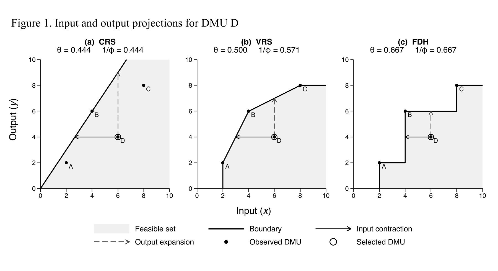
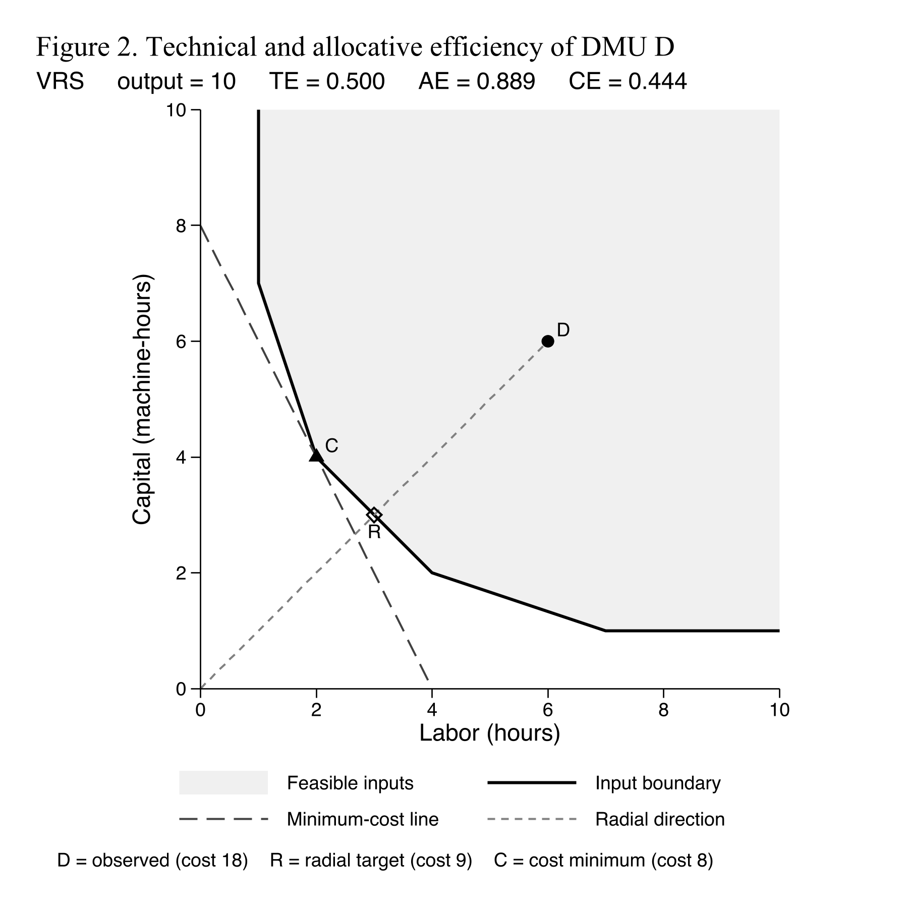
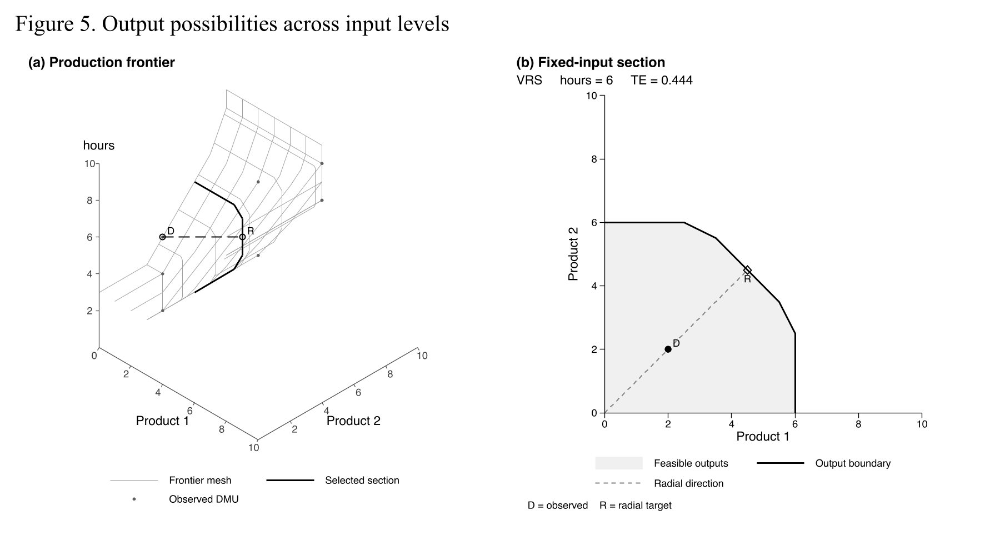

# graphdea

Draw monochrome data envelopment analysis (DEA) graphs in Stata using your own data. Compare production frontiers, trace a decision-making unit's projection onto the frontier, or show how input prices change its cost-minimizing target. The command supports one input and one output, two inputs and one output, or one input and two outputs. It also draws Malmquist productivity comparisons for panel data.

Version 0.30.1 requires Stata 16 or later. The Mata routines are included in the ado-file.

## Install from a local copy

Reviewers with repository access can download and extract the ZIP from GitHub or clone the repository. In Stata, set the path below to the folder containing `graphdea.pkg` and `stata.toc`. Run the commands from your own analysis directory.

```stata
local pkg "/path/to/graphdea"
net install graphdea, from("`pkg'") replace
which graphdea
help graphdea
```

To try a complete example, copy the example do-files into your working directory and run one. The examples supply their own data and restore the dataset in memory.

```stata
net get graphdea, from("/path/to/graphdea")
do example_1x1.do
```

## Use your own data

Suppose each row describes one plant, with numeric input `labor`, numeric output `units`, and a string identifier `plant`. The first command draws the frontier. The second compares constant and variable returns to scale for plant D. Substitute your variable names and an identifier present in your sample.

```stata
graphdea labor = units
graphdea labor = units, dmu(plant) focus("D") compare(crs vrs) name(frontier, replace)
matrix list r(projections)
graph export "frontier.pdf", name(frontier)
```

Use `if` or `in` to select the reference sample. Type `return list` immediately after the command to inspect the results for a view. In `help graphdea`, **Guide to views** lists the diagrams by research question and **Customizing graph appearance** covers colors, fonts, and Graph Editor recordings.

## Example figures

### One input and one output

The three panels use the same observations. The arrows project unit D onto the CRS, VRS, and free disposal hull frontiers in the input and output directions. [Run the comparison](example_1x1.do).



### Two inputs and one output

At a fixed output level, the radial projection measures the proportional input reduction available to D. The price line locates the least-cost input mix. [Run the Farrell decomposition](example_2x1.do).



### One input and two outputs

The surface shows how attainable output combinations change with the input budget. The adjacent panel shows the section through unit D. Run `do example_surface.do` and display `dea_surface_out` for the figure below. To rotate the surface, try `do example_surface.do 135 25`, with azimuth and elevation in degrees. [Run the surface example](example_surface.do).



## Development and verification

The [package manifest](graphdea.pkg) lists the installed command, its help, and the 25 optional examples. The [test do-files](tests/) exercise the command, its returned results, and its Mata geometry. Run tests in a fresh Stata session because they create and clear test data. For example, after installation, run `do "/path/to/graphdea/tests/selectors.do"` to check decimal identifiers, periods, and slice levels.

When editing the ado-file, run [graphdea_reload.do](graphdea_reload.do) from the repository root to load the working copy.

## Author and citation

Package author and contact: Choonjoo Lee <bloom.rampike@gmail.com>.

To cite this version: Lee, Choonjoo. 2026. *graphdea: Data envelopment analysis graphs*. Stata package, version 0.30.1. [Repository](https://github.com/renegade68/graphdea).

For the background to the 3D graphics, see Choonjoo Lee’s reply of 23 October 2026 (post #4) on viewing a surface with a highlighted cross-section. Chen Samulsion opened the discussion and illustrated Lee’s projection code. The filled DEA section in `graphdea` draws on Lee’s *From automatic layout to 3D geometry* example, which acknowledges Samulsion’s surface illustration. [Statalist discussion](https://www.statalist.org/forums/forum/general-stata-discussion/general/1787645-surface_view-a-150-plus-line-piece-of-code-brimming-with-geek-spirit).

## License

Copyright © 2026 Choonjoo Lee. Licensed under the Academic Free License version 3.0 (SPDX: `AFL-3.0`). [Full license text](LICENSE).
